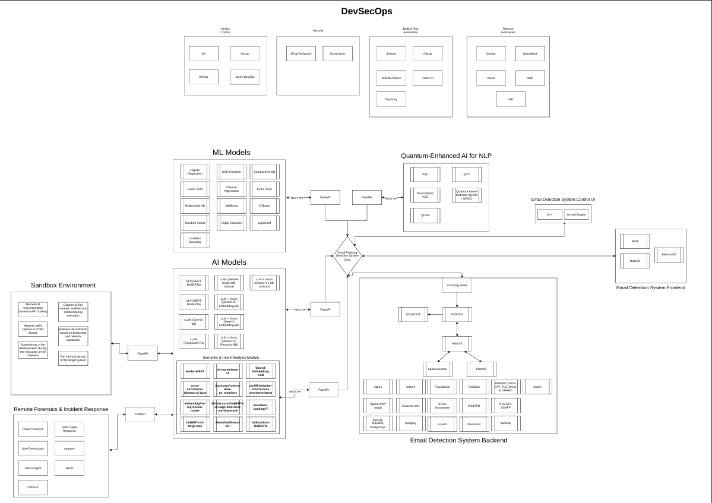

# MailPhish
This thesis diagram illustrates a complex, multi-layered architecture for an Email Detection System, integrating advanced AI, quantum-enhanced processing, and automated security workflows. The system is designed to detect and respond to threats through a sophisticated pipeline of analysis modules.1. Core Analysis EngineThe heart of the system consists of three distinct modeling approaches that communicate via FastAPI to the central detection core:ML Models: Employs classical machine learning techniques including SGD Classifier, Linear SVM, and Random Forest for baseline classification.AI Models & Semantic Module: Features deep learning architectures like RoBERTa, ModernBERT, and DeBERTa. These are supported by a Semantic & Intent Analysis Module to understand the context of incoming emails.Quantum-Enhanced AI for NLP: Incorporates cutting-edge quantum methodologies, utilizing Variational Quantum Circuits (VQC), Quantum Reservoir Computing (QRC), and Quantum Neural Networks (QNN) to enhance natural language processing capabilities.2. Backend & Frontend InfrastructureThe operational environment is split into specialized functional blocks:Email Detection System Backend: Manages the mail flow using Dovecot, Postfix, and Amavis. It handles security protocols such as SPF, DKIM, and DMARC, while utilizing PostgreSQL and LDAP for data and identity management.User Interfaces: The system provides a Control UI (developed with C++ and Unreal Engine) for administrative oversight and a Frontend (using ReactJS and Svelte) for user interaction.3. Security, Forensics, and DevSecOpsThe architecture is wrapped in a robust security and deployment framework:Sandbox Environment: Facilitates safe execution of suspicious content, capturing PCAP (packet captures), behavioral instrumentation, and full memory dumps.Remote Forensics & Incident Response: A dedicated module for post-detection actions, utilizing tools like Velociraptor, GRR Rapid Response, and CAPE for deep-dive investigations.DevSecOps Pipeline: Ensures continuous integration and security through four stages: Version Control (GitHub, Azure DevOps), Security (SonarQube), Build & Test Automation (GitHub Actions, Travis CI), and Release Automation (AWS, Azure, Docker).

# A degree mill (or diploma mill) is a fraudulent organization issuing degrees for payment with little or no academic work, study, or student assessment. INNOPOLIS UNIVERSITY©

Innopolis University - SNE

